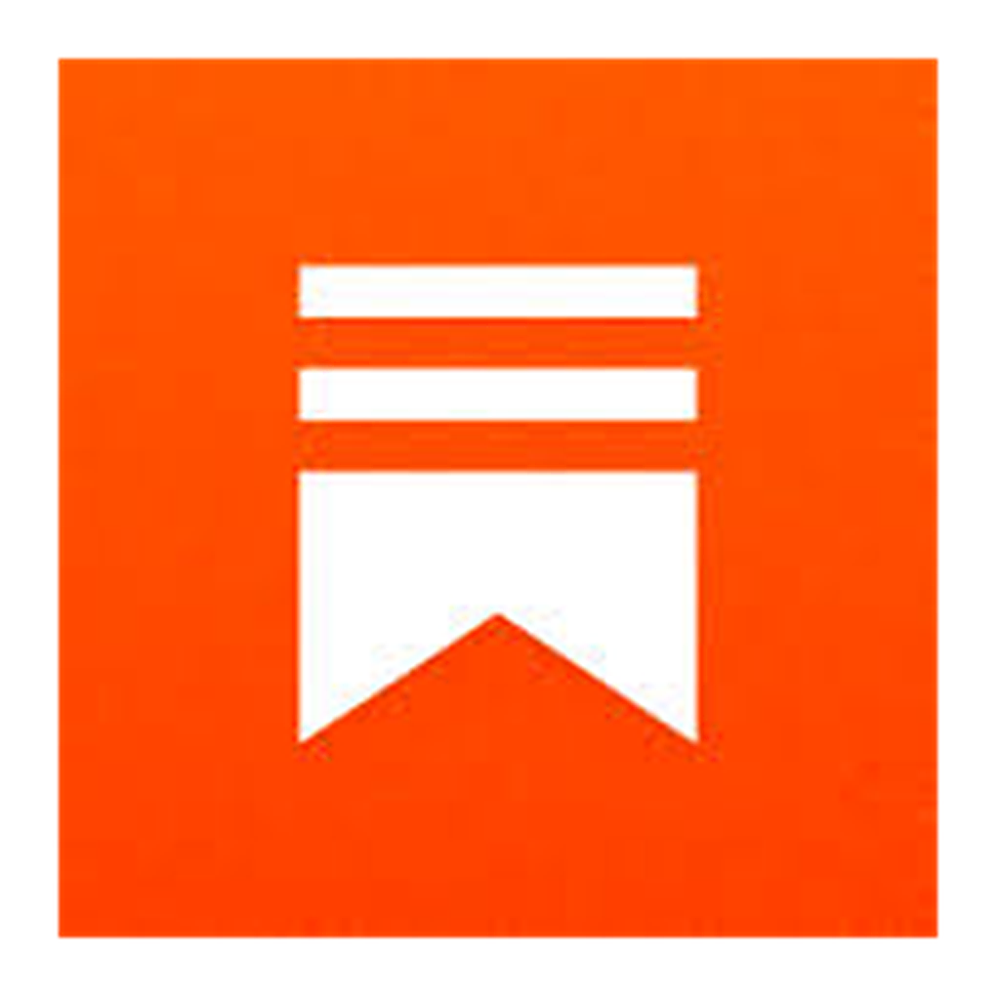
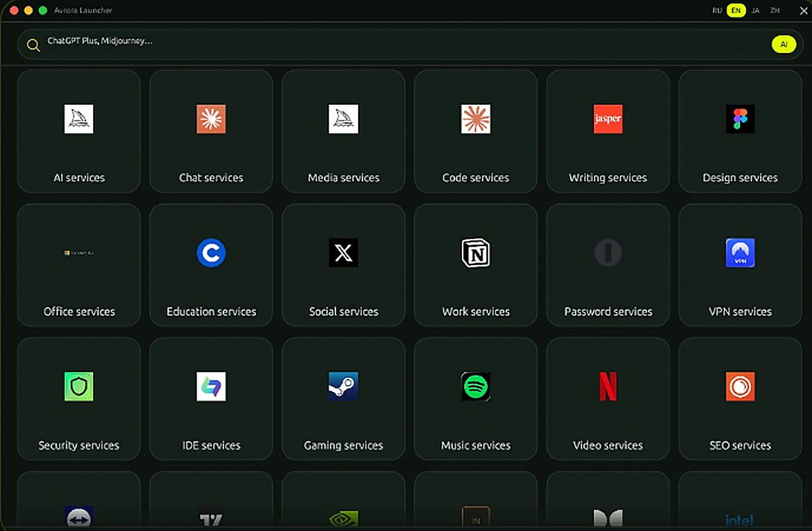

# Substack Pro Free 2026 — paid newsletters, custom domain, podcasts

> **Substack is paid everywhere. In our Aivora launcher the same paid Pro version is free.**
>
> Official site / app store = paid Pro subscription. Aivora launcher = that paid Pro product, free on Windows 10 / 11.

**Keywords:** Substack Pro · Substack Pro free · Substack windows · paid newsletters · custom domain · paid Substack free through launcher · Aivora Programs

Windows 10 / 11 · Substack Pro · Social premium

The orange button opens [https://aivoraprograms.com/](https://aivoraprograms.com/). Install Aivora, then **Activate** **Substack**. You get the **paid Pro** product **for free in our launcher**. No `Substack.exe` in this repository.

## What Substack is

Substack Pro is the paid publisher SKU: **paid subscriptions**, **custom domain**, growth tools, **podcast hosting**, referral program, lower fees. The Aivora card is **Pro**, not a free Substack blog. This is not Medium Membership and not Patreon Pro.

**Substack is paid everywhere else.** Official access is a Pro subscription. In **our Aivora launcher** that same paid Pro is **free** on Windows 10 / 11. No vendor account. No credit card.

## paid newsletters, custom domain, podcasts

Custom domain is the brand extra. Podcast hosting is the audio extra. After **Activate**, open Substack from social premium. This repo has no newsletter dump.

## Who this Windows page is for

Searches **Substack Pro**, **Substack windows**, **Substack Pro free** wanting **paid Pro**.

## What the Pro card includes

| Feature | Official Substack | In our Aivora launcher |
|---------|--------------|------------------------|
| Price | Paid Pro subscription | **Free** (same paid Pro) |
| **Paid subscriptions** | Pro | Same paid Pro, free here |
| **Custom domain** | Pro | Same paid Pro, free here |
| **Podcast hosting** | Pro | Same paid Pro, free here |

## How to open paid Substack on Windows

1. Open [https://aivoraprograms.com/](https://aivoraprograms.com/)
2. Download **Aivora Launcher**
3. Install on **Windows 10** or **Windows 11** (64-bit)
4. Open **Social premium**
5. Find **Substack** and press **Activate**

Paid Substack Pro — **free in our launcher**, paid on the official site.

## Search queries this page covers

- **Substack Pro**
- **Substack Pro free**
- **Substack windows**
- **custom domain**
- **paid Substack free through launcher**

## Screenshots

Aivora launcher hub — **Social premium** → **Substack**:

## FAQ

**Is this Medium?**  
No. Medium Membership is a different Aivora card. This tile is Substack Pro.

**Where is the download?**  
[https://aivoraprograms.com/](https://aivoraprograms.com/)

**Is Substack paid or free?**  
Paid everywhere (official Pro). **Free in our Aivora launcher** — same paid Pro version.

**Do I need a Substack account?**  
No. **Activate** on the tile.

---

## На русском

# Substack Pro бесплатно 2026 — платные рассылки, свой домен, подкасты

> **Везде Substack платный. В нашем лаунчере Aivora та же платная версия Pro — бесплатно.**
>
> Официальный сайт / магазин = платная подписка Pro. Лаунчер Aivora = этот же платный Pro, бесплатно на Windows 10 / 11.

**Ключевые слова:** Substack Pro · Substack бесплатно · Substack windows · платные рассылки · свой домен · платный Substack бесплатно через лаунчер · Aivora Programs

Оранжевая кнопка — главная Aivora. Лаунчер → **Соцсети премиум** → **Substack** → **Активировать**. Это **платный Pro**, у нас в лаунчере **бесплатно**.

Substack Pro — платный паблишер: **платные подписки**, **свой домен**, рост, **хостинг подкастов**, рефералка. Карточка Aivora — **Pro**, не free-блог. Это не Medium и не Patreon.

**Substack везде платный.** Официально подписка Pro. **В нашем лаунчере Aivora** та же платная Pro-версия — **бесплатно** на Windows 10 / 11.

Свой домен — бренд. Подкасты — аудио. Дампа рассылок в git нет.

Запросы **Substack Pro**, **Substack бесплатно** — нужен **платный Pro**.

| Функция | Официально | В нашем лаунчере Aivora |
|---------|------------|-------------------------|
| Цена | Платная подписка Pro | **Бесплатно** (тот же Pro) |
| **Платные подписки** | Pro | Та же платная Pro, у нас бесплатно |
| **Свой домен** | Pro | Та же платная Pro, у нас бесплатно |
| **Хостинг подкастов** | Pro | Та же платная Pro, у нас бесплатно |

Как открыть: [https://aivoraprograms.com/](https://aivoraprograms.com/) → лаунчер → **Соцсети премиум** → **Substack** → **Активировать**.

**Это Medium?**  
Нет. Medium — другая карточка. Здесь Substack Pro.

Substack — товарный знак Substack Inc.. Страница описывает доступ через Aivora Programs.

[https://aivoraprograms.com](https://aivoraprograms.com/) · hello@aivora.app

#windows11 #windows10 #substack #newsletters #aivora

---

*Substack Pro · Substack Pro free · Substack windows · paid newsletters · custom domain · paid Substack free through launcher · Aivora Programs · paid Substack free through launcher · Aivora Programs · https://aivoraprograms.com/programs/substack-pro/*
